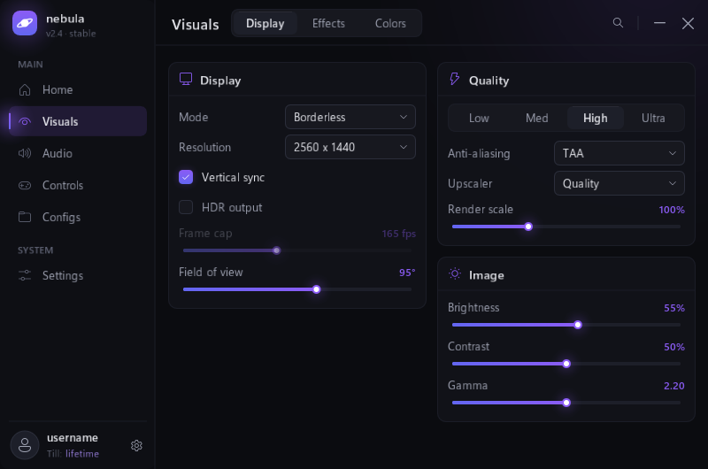

# Nebula: a compact Dear ImGui menu

A compact (800×530), modern Dear ImGui 1.93 menu for Windows (Win32 + Direct3D 9), designed in Figma first
and then built to match. Everything inside the window is drawn by ImGui: header, sidebar, groups, widgets,
popups and toasts.



**Design source:** [Nebula: Compact ImGui Menu (Figma)](https://www.figma.com/design/uqVRn7YvuzG0t58eTUbnL8)
holds the `Nebula` variable collection (colors, radii, spacing), a component sheet (Checkbox, Toggle,
Slider, Dropdown, Keybind, Swatch, NavItem, Tab, Notification) and a 760×500 reference frame. The colors
in `src/theme.cpp` mirror those variables one to one; the app has since grown slightly (800×530, larger
text) to keep the type readable.

## Build

Requires CMake 3.20+, Ninja, and either MinGW-w64 g++ (tested with 13.2) or Visual Studio 2022.

```bash
cmake -S . -B build -G Ninja -DCMAKE_BUILD_TYPE=Release
cmake --build build
build\nebula.exe
```

Dear ImGui is vendored in `third_party/imgui` (cloned from `ocornut/imgui`, master @ 1.93 WIP), and
FreeType 2.14.3 in `third_party/freetype` (from `gitlab.freedesktop.org/freetype/freetype`). FreeType is
built as a static library with no optional dependencies, so `nebula.exe` stays a single file.

## Typography

- Face: **Segoe UI Variable** (Windows 11's UI font) in its "Text" optical size, picked from the variable
  font through FreeType named instances (Regular / Semibold Text / Bold Text). Windows 10 falls back to
  classic Segoe UI.
- Rasterized by FreeType with light hinting (`theme::LoadFonts`).
- One type scale in `theme.h`: 11 / 12 / 13 / 14 / 17 px. ImGui sizes a font by its full line height
  (ascender + descender), which for Segoe UI is 1.33 em, so the constants are written as `em * kEm`.
  Without that factor every size renders about 25% smaller than intended.
- Numbers use the UI font (Segoe has tabular digits); monospace is only used for hex color codes.

## Layout

| Page | Sub-tabs |
|---|---|
| Home | Overview (live render time / memory / CPU, quick actions with hotkeys, health rings), Activity |
| Visuals | Display, Effects (group master switches, color swatches, key chips), Colors |
| Audio | Mixer, Equalizer (draggable 10-band EQ) |
| Controls | Mouse, Keybinds |
| Configs | List, details, create / load / duplicate / delete, clipboard export & import |
| Settings | Appearance (accent, radius, animations, glow, compact sidebar), About |

## Widgets (`src/widgets.cpp`)

- `BeginGroup / EndGroup`: titled card with a 38px header; pass `bool* enabled` for a header switch that disables the body.
- `Checkbox`, `CheckboxColor` (inline swatch + picker), `CheckboxKey` (inline keybind chip).
- `Slider`, `Combo`, `Keybind`, `ColorRow`, `Pills` (segmented / sub-tabs), `ToggleMini`, `AccentPicker`, `KeyValue`.
- `Button` (primary / ghost / danger), `IconButton`, `Badge`, `Notify` toasts.
- Charts: `LineChart`, `StatCell` with sparkline, `Ring`, `Equalizer`, `LevelMeter`.

All of them go through ImGui's item system (`ItemAdd` / `ButtonBehavior`), so IDs, keyboard nav and
`BeginDisabled()` keep working. Every widget draws a focus ring when reached with the keyboard, long
labels are cut with an ellipsis (`ui::TextFit`), and tooltips, the color picker and the scrollbar
(`ui::OverlayScrollbar`) are themed instead of using ImGui's defaults. Per-widget animation state lives
in `ui::Anim()` and is pruned for widgets that haven't been drawn for a while.

## Rendering

Direct3D 9, through the **9Ex** interface with the `FLIPEX` swap effect: still `d3d9.dll` and an
`IDirect3DDevice9` for ImGui's DX9 backend, but frames are handed to DWM directly instead of being copied
into a redirection surface (plain D3D9 windowed presents cost about 5 ms of CPU per frame here). Resizes
and monitor changes go through `ResetEx`; a removed or hung device is rebuilt.

The window only redraws on input, while something animates, and otherwise at a slow heartbeat chosen
by `menu::IdleDelay()` (1 s on static pages, 10 Hz on the live Home stats, ~30 Hz for the audio level
meter). Frames are paced by the main loop, not the driver: it reads the next vblank from DWM
(`DwmGetCompositionTimingInfo`) and sleeps on a high-resolution waitable timer, so there is at most one
frame per display refresh and nothing busy-waits. Measured on this machine: about 1.3% of one CPU core
on the live Home page, around 15% only while something is animating at full refresh rate.

Moving the window to a monitor with a different scale is handled in `WM_DPICHANGED`: the window is
resized to the exact scaled size and `theme::SetDpi()` re-applies every size.

## Account and notifications

- The sidebar shows your Windows account name (override with the `NEBULA_USER` environment variable)
  and `avatar.png` / `avatar.jpg` from the exe folder, center-cropped to a circle. Without an image it
  falls back to a plain person glyph.
- `ui::Notify(kind, text, highlight)` shows a one-line log entry at the bottom-right:
  `[mark] | Performance mode enabled`, with the highlight in the accent (or warning/danger) color and a
  hairline timer along the bottom edge.

## Shortcuts

| Keys | Action |
|---|---|
| Ctrl+K | Search settings (Enter jumps to the first match) |
| Ctrl+1 … Ctrl+6 | Switch page |
| Arrows / Tab | Move focus; Space or Enter activates |
| Left / Right on a slider, Up / Down on an EQ band | Adjust the value (Shift = 10x on sliders) |
| F5 / F1 / F9 (rebindable) | Performance mode / Overlay / Photo mode |
| Right-click a key chip | Clear the binding |

## Command line

```bash
build\nebula.exe --shots docs
```

Renders every page and sub-tab, lets the animations settle, and writes `view_N.bmp` from the back buffer.
Add `--dpi 144` (or any DPI) to apply a scale change at startup through the same `WM_DPICHANGED` path
Windows uses when the window moves between monitors.

## Source layout

| Path | Contents |
|---|---|
| `src/main.cpp` | Window, D3D9Ex device, vblank-paced on-demand frame loop, DPI handling, avatar loading |
| `src/theme.*` | Tokens (mirrors the Figma variables), fonts, style |
| `src/widgets.*` | All custom widgets, tooltips, color picker, scrollbar, notifications |
| `src/menu/shell.cpp` | Sidebar, header, search palette, hotkeys, root frame |
| `src/menu/stats.cpp` | Live process stats and the activity log |
| `src/menu/page_*.cpp` | One file per page |
| `src/menu/internal.h` | Settings state and helpers shared by the files above |

## Extending

- Colors / radii: `theme::Setup()` and `theme::kAccents` (keep them in sync with the Figma variables).
- New page or sub-tab: write it in a `src/menu/page_*.cpp`, declare it in `internal.h`, add it to `kNav`
  and `DrawView()` in `shell.cpp`. Search picks up its labels automatically: the index is built at
  startup from the labels widgets actually submit.
- Settings live in `menu::State S` (`internal.h`). Nothing is persisted to disk yet.

## Third-party

- [Dear ImGui](https://github.com/ocornut/imgui), MIT license.
- [FreeType](https://freetype.org), FreeType License (FTL). Portions of this software are copyright
  © 2026 The FreeType Project (www.freetype.org). All rights reserved.
- Fonts (Segoe UI Variable, Segoe UI, Segoe Fluent Icons, Cascadia Mono) are loaded from the Windows fonts folder at run time and are not redistributed.
